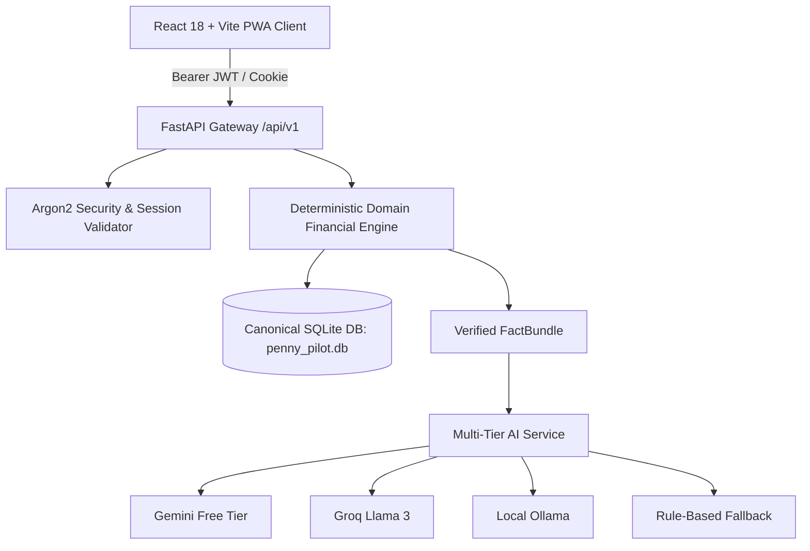
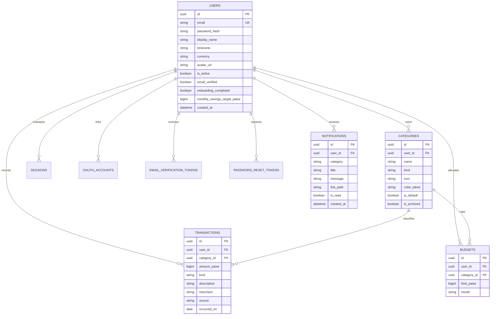
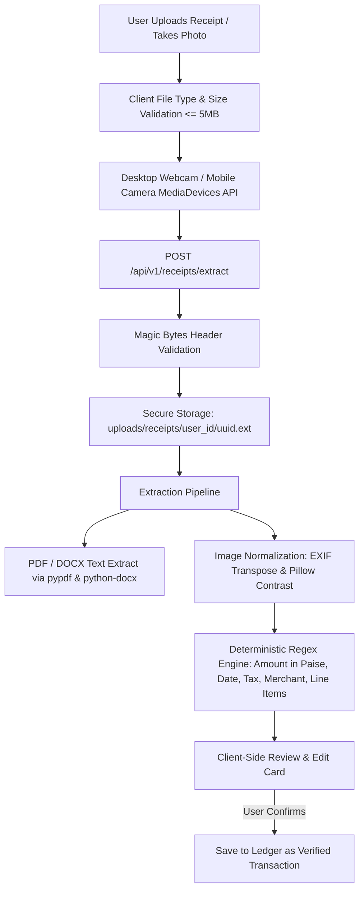

# PennyPilot — System Architecture & Engineering Principles

> **Reference:** Supporting Architecture Document for `PROJECT_MASTER_LOG.md`  
> **Status:** Active & Maintained  
> **Last Updated:** 2026-11-07

---

## 1. Prime Directives & Engineering Constitution

### 1.1 Compute, Then Explain (Zero Financial Hallucination)
- The Large Language Model (LLM) must **never** compute arithmetic, sums, balances, or pacing targets.
- All calculations are executed deterministically in pure Python functions inside `backend/app/domain/`.
- Verified domain outputs are packaged into a immutable `FactBundle` structure.
- The LLM only receives this verified `FactBundle` and translates it into explanatory narration.
- LLM responses are verified against the numerical values in `FactBundle` before presentation to the user.

### 1.2 Strict Integer Paise Convention
- Floating-point representations (`float`) are strictly forbidden for monetary storage and math.
- All amounts in database columns, SQLAlchemy models, Pydantic validation schemas, and domain calculation functions are integer **paise** ($₹1.00 = 100\text{ paise}$).
- Currency formatting into INR standard notation (`₹XX,XX,XXX.XX`) occurs exclusively at the UI presentation boundary (`frontend/src/lib/currency.ts`).

### 1.3 Multi-Tenant User Isolation
- Every database query for user-owned assets (transactions, categories, budgets, goals, insights) strictly filters on `user_id`.
- Unbounded queries across tenants are strictly barred.
- Authorization is validated server-side on every request using Bearer JWT tokens or verified session cookies.

### 1.4 Strict Zero-Budget ($0) Guarantee
- No dependencies requiring mandatory credit cards or paid API keys.
- **AI Fallback Chain:** Hosted Free Tier (Gemini 1.5 Flash / Groq Llama 3) $\rightarrow$ Local Ollama (Qwen 2.5:3B) $\rightarrow$ Deterministic Python Engine.
- If network access or AI services fail, the platform operates seamlessly using rule-based algorithms.

---

## 2. Layered Architecture

### 2.1 Canonical Database Resolution
- **File Location:** `D:\projects\PennyPilot\penny_pilot.db` (anchored to project root via `backend/app/core/config.py`).
- **Alembic Head:** `c1a2b3c4d5e6` (adds `onboarding_completed` and `monthly_savings_target_paise` to `users`).
- **Integrity Validation:** Enforces `PRAGMA foreign_keys = ON` in runtime connections and batch migration mode for SQLite table alterations. All migration tests execute exclusively on disposable test databases without mutating the canonical database file.

### 2.2 Income & Financial Planning Architecture
- **Transaction Model Reuse:** Income records reuse the existing `transactions` table with `kind="income"`, `amount_paise`, `occurred_on`, and `merchant` as the income source. This eliminates duplicate schemas and ensures that historical analytics, monthly summaries, and MAD anomaly detection seamlessly incorporate income without synchronization lag.
- **Deterministic Separation of Actual vs Planned Savings:**
  1. $\text{Actual Savings} = \text{Actual Income} - \text{Actual Expenses}$ (Retained net capital).
  2. $\text{Remaining Budget} = \text{Allocated Budget} - \text{Actual Expenses}$ (Spendable ceiling buffer).
  3. $\text{Planned Savings Cushion} = \text{Monthly Income} - \text{Allocated Budget}$ (Projected surplus after fully funding category budgets).
  4. $\text{Unallocated Income} = \text{Monthly Income} - \text{Allocated Budget}$.
  5. Strict rule: Planned savings is never presented as actual savings.
- **First-Time Guided Onboarding:** Non-blocking 6-step setup wizard presented to new users upon email verification; existing users evaluate `onboarding_completed = 1` by default. Allows non-intrusive deferral via Dashboard reminder banner.

---

## 3. Database Schema Overview

---

## 4. Period Analytics & Pacing Engine Principles

### 4.1 Strict Annual Aggregation
- **Zero Extrapolation Rule:** Annual actual income is computed solely by summing transactions occurred within that calendar year (`date(year, 1, 1)` to `date(year, 12, 31)`).
- Monthly income is **never** multiplied by 12 to manufacture annual totals.
- Projected recurring annual income is calculated separately from active recurring rules and explicitly labeled as a projection.

### 4.2 Dynamic Budget Buffer Derivation
- Budget ceilings are never hardcoded or stored separately; they are computed dynamically from `SUM(budgets.limit_paise)` for the active user and month.
- Budget buffer is `MAX(0, limit_paise - spent_paise)`.
- If budget limit is 0, pacing status cleanly reflects unbudgeted spend without division-by-zero or false positive savings claims.

---

## 5. Receipt Processing & Optical Character Recognition Architecture

### 5.1 Zero-Budget ($0) Local Architecture
- **Free Document & Text Parsing:** Local `pypdf.PdfReader` and `python-docx` extract native text directly without external services or network calls.
- **Image Preprocessing:** Python Pillow (`PIL.Image`, `PIL.ImageOps.exif_transpose`, `ImageEnhance.Contrast`) handles image orientation, dimensions, and visual normalization.
- **Deterministic Regex Parser:** Extracts merchant name, dates in common Indian and ISO formats (`YYYY-MM-DD`, `DD-MM-YYYY`, `DD-Mon-YYYY`), tax lines (CGST/SGST/Total Tax), line items with quantities, and total amount stored strictly in integer paise.
- **Hosted Multimodal Vision Fallback:** If local text parsing is inconclusive and free-tier Gemini API is configured, images are safely passed to Gemini for OCR extraction, with immediate fallback to manual review.

### 5.2 Security & Multi-Tenant Directory Partitioning
- Uploaded receipt files are strictly saved in segregated per-user directories: `uploads/receipts/{user_id}/{file_id}.{ext}`.
- Path traversal attacks are mitigated by sanitizing filenames and asserting that resolved file paths start with `RECEIPT_UPLOAD_DIR / str(user_id)`.
- Physical files are unlinked on single-file delete (`DELETE /api/v1/receipts/file/{file_id}`) and recursively purged on permanent account deletion (`DELETE /api/v1/account/me`).

### 5.3 Mandatory User Confirmation Boundary
- Under the Zero Financial Hallucination principle, receipt OCR **never** auto-commits transactions into the database ledger.
- Extracted data is presented to the user in an editable review card where Merchant, Amount, Date, Category, Description, and Notes can be modified or verified before clicking "Record in Ledger".

---

## 6. Document Export Engine Architecture

PennyPilot provides client-side reporting and document generation without external SaaS dependencies or server renderers:
- **CSV Spreadsheets:** Deterministic tabular format with header rows, escaped fields, and integer paise converted cleanly to decimal INR.
- **PDF Statements:** Rendered via `jspdf` and `jspdf-autotable` using Quiet Ledger visual hierarchy, official header banners, summary telemetry tables, and certification footers.
- **DOCX Word Documents:** Generated via the `docx` JavaScript library with formal document headings, key metrics tables, and compliance statements.
- **Supported Modules:** Transactions Ledger, Financial Insights, Historical Analytics, and Monthly Financial Statements.

---

## 7. Floating Assistant & Multimodal Voice Architecture

- **Floating Draggable Assistant:** Persistent robot-head assistant mounted in `App.tsx` (`FloatingCopilotButton.tsx`). Supports mouse and touch dragging bounded to the viewport with a gentle idle animation.
- **Contextual Copilot Drawer:** Interactive slide-out chat window supporting suggested question chips, conversation history with real Markdown formatting, and quick expand-to-page navigation.
- **Web Speech API Integration:** Speech-to-text voice input via `webkitSpeechRecognition` and `SpeechRecognition` with live audio listening states, transcript preview before submission, and graceful fallback for browsers without microphone permissions.

