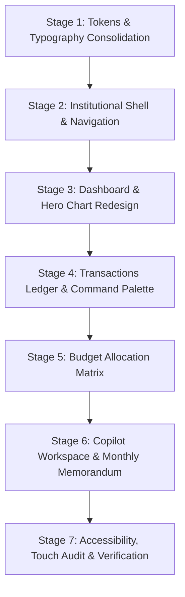

# PENNYPILOT — PHASE 4 DESIGN AUDIT & PRODUCT REDESIGN BLUEPRINT
**Role:** Principal Product Designer, Senior Frontend Architect & Design-System Engineer  
**Date:** 2026-11-06  
**Status:** **INSPECTION & DESIGN-PLANNING ONLY (No Source Modifications)**  
**Target Design Direction:** Quiet Ledger Editorial Fintech (Mercury, Linear, Ramp caliber)

---

## Executive Summary

PennyPilot Phases 1, 2, and 3 delivered an engineering-grade financial platform: deterministic pure-Python domain arithmetic, integer-paise accounting, multi-tenant isolation, 3-tier zero-budget AI fallback, and verified FactBundle grounding.

However, the current user interface suffers from visual tropes common in prototype-stage and AI-generated dashboards:
- Puffy rounded corners (`rounded-2xl` on nearly every container)
- Soft gradient washes (`bg-gradient-to-br from-surface to-amberLight/20`)
- Repetitive, generic KPI cards with decorative icon boxes
- Consumer chat-bubble paradigms with cartoonish robot avatars
- Low information density that forces excessive vertical scrolling

This audit establishes the **Phase 4 Redesign Blueprint**: transforming PennyPilot into an **editorial, high-density financial intelligence platform**. It pairs typographic authority (Newsreader serif + Inter sans + JetBrains Mono) with razor-sharp 1px hairline borders, disciplined whitespace, and dense data layouts reminiscent of Mercury, Linear, and Ramp.

Crucially, this audit also diagnoses and documents the exact root cause of the **zero-data dashboard** observed when running the backend locally.

---

## 1. Current UI Assessment & Critique

### 1.1 Global Design Language Defects
| Aesthetic / UX Defect | Current Implementation | Product Impact | Proposed Redesign Direction |
|---|---|---|---|
| **Excessive Border Radii** | `rounded-2xl` (16px) applied to cards, tables, inputs, badges, and modals. | Looks playful, soft, and consumer-mobile rather than institutional financial software. | Standardize on crisp `rounded-lg` (8px) for major cards, `rounded-md` (6px) for inputs/buttons, and `rounded` (4px) for micro-tags. |
| **Pill Badge Saturation** | Pill badges (`rounded-full px-3 py-1`) used indiscriminately for statuses, categories, dates, and AI tiers. | Visual clutter; badges lose semantic meaning when everything is shaped like a pill. | Use rectangular micro-tags (`px-2 py-0.5 rounded text-[11px] font-mono`) with 1px border outlines and muted neutral backgrounds. |
| **Decorative Icon Boxes** | Lucide icons enclosed in pastel rounded boxes (`w-8 h-8 rounded-lg bg-ledger-bg border flex items-center justify-center`). | Generic SaaS visual filler that steals horizontal space from financial descriptions. | Eliminate decorative icon containers. Let financial descriptions and categories lead; use monochrome micro-icons only where functional. |
| **Subtle Gradient Washes** | `bg-gradient-to-br from-ledger-surface to-ledger-amberLight/20` in insight cards. | Visual noise; looks like marketing landing page cards rather than a ledger terminal. | Pure flat surface cards (`#FFFFFF`) with 1px hairline borders (`#E5E0D8`) and 2px solid left accent borders for severity indicators. |
| **Chat Bubble Paradigm** | Conversational AI uses speech bubbles (`rounded-2xl rounded-tl-none`) with `Bot` and `User` avatar circles. | Demotes institutional financial intelligence into a casual customer-support widget. | Transform into an **Editorial Intelligence Workspace**: structured memorandum format, clear section dividers, and integrated evidence drawers. |
| **Low Information Density** | Excessive padding (`p-6 md:p-8`) and wide gaps (`space-y-6 md:space-y-8`) limit viewport visibility. | Users must scroll continuously to see basic transactions and budget status. | Increase information density by 40%: dense 36px table rows, compact telemetry strips, and multi-column ledger alignments. |

---

### 1.2 Screen-by-Screen Component Critique

#### A. Dashboard (`VerdictStrip.tsx`, `BudgetPaceHeroChart.tsx`, `CategoryBreakdownCard.tsx`, `RecentTransactionsCard.tsx`, `InsightCards.tsx`)
- **VerdictStrip:** While the headline verdict sentence is a strong functional concept, the four KPI cards below it (`Income`, `Expenses`, `Net Balance`, `Savings Rate`) use repetitive, cookie-cutter layouts with stock icons (`TrendingUp`, `TrendingDown`, `Wallet`, `PiggyBank`).
- **Hero Chart:** The SVG chart renders clean lines, but lacks interactive micro-tooltips, uses thick dashed lines (`strokeDasharray="4 4"`), and features a pulsing green circle marker that feels distracting.
- **Category Breakdown:** Uses generic rounded progress bars (`rounded-full h-2`). Lacks direct comparison to monthly budget allocations or previous month baselines.
- **Recent Transactions Card:** Shows only 5 items with large vertical padding and generic receipt icons.
- **Insight Cards:** Three cards stacked or in a 3-column grid with gradient backgrounds that compete with the hero chart for visual dominance.

#### B. Transactions Ledger (`TransactionList.tsx`)
- **Controls Bar:** Filters and search inputs are scattered across a multi-column grid with heavy borders.
- **Table Design:** The table uses standard HTML rows with thick 12px padding. Category tags are rounded pill badges that cause uneven row heights.
- **Edit Modal:** Standard centered modal with basic form fields; lacks context of the surrounding ledger entries or running balances.
- **Pagination / Virtualization:** Renders all filtered transactions directly in the DOM without pagination or virtual scrolling.

#### C. Budgets Matrix (`BudgetManagement.tsx`)
- **Aggregate KPI Strip:** Repeats the same 3-card pattern (`Overall Limit`, `Month Spent`, `Remaining Buffer`) with an oversized progress bar.
- **Category Grid:** Renders categories as independent 2-column cards. While functional, cards make it difficult to compare spending velocity across 10+ categories simultaneously. A unified **Budget Ledger Matrix** table is much more effective for high-volume budgeting.

#### D. Grounded AI Copilot (`CopilotView.tsx`, `EvidencePanel.tsx`)
- **Status Header:** The provider status pill with a pulsing green dot looks like a standard network monitor.
- **Prompt Chips:** Stored as pill buttons wrapped in a container that wraps awkwardly on medium screens.
- **Evidence Drawer:** The `EvidencePanel` contains rich verified data (period telemetry, category breakdown, anomalies, MoM shifts), but is buried inside an expandable accordion inside individual chat bubbles. It should be elevated to a persistent side inspection panel.

#### E. Monthly Intelligence Report (`MonthlyReportModal.tsx`)
- **Modal Wrapper:** Uses a generic floating modal overlay. The report contains publication-grade data, but reading it inside a scrollable 90vh popup diminishes its editorial weight.
- **Formatting:** Looks like an expanded web form rather than a formal financial document. It should present as an institutional **Financial Health Briefing** suitable for executive review and clean PDF export.

#### F. Quick Add Transaction Modal (`NLQuickAddModal.tsx`)
- **Tab Switcher:** Toggle between "Natural Language" and "Manual Form" uses pill buttons inside a grey box.
- **Review Table:** The drafted transactions appear inside an editable card list that consumes significant vertical space. It should behave like a fast, keyboard-first command palette (`Cmd+K` style).

---

## 2. Existing Component & Architecture Inventory

PennyPilot's current codebase possesses excellent, robust foundations that must be preserved without regressions:

### 2.1 Reusable Architecture & Logic to Preserve
1. **Financial Domain Calculations (`backend/app/domain/`):** Pure Python integer-paise arithmetic, zero floating-point math, 100% deterministic aggregates, MAD anomaly detection, and budget pace modeling.
2. **FactBundle Grounding Engine (`backend/app/domain/copilot.py`):** Verified facts, MoM delta calculations, and the multi-rule `FactBundleVerifier`.
3. **AI Fallback Orchestration (`backend/app/services/ai_client.py`):** Hosted Gemini $\rightarrow$ Local Ollama $\rightarrow$ Deterministic Python Engine.
4. **Data Fetching Layer (`frontend/src/lib/api.ts`):** Complete TanStack Query hooks, typed interfaces (`TransactionItem`, `MonthlySummary`, `BudgetPace`, `MonthlyBudgetOverview`), and offline error handling.
5. **Currency Formatter (`frontend/src/lib/currency.ts`):** Deterministic Indian numbering system formatting (`formatINR`, `paiseToRupees`, `rupeesToPaise`).
6. **Authentication & Isolation (`frontend/src/context/AuthContext.tsx`):** Token storage, bearer headers, demo login auto-initialization, and user tenant isolation.

### 2.2 Components Requiring Purely Visual & Layout Redesign
| Component File | Role | Preservation Scope | Redesign Scope |
|---|---|---|---|
| `Navbar.tsx` | App header & navigation | Preserve tab routing, mobile safe area, health queries. | Transform into an ultra-clean institutional header with compact text tabs and refined logo typography. |
| `VerdictStrip.tsx` | Headline financial verdict | Preserve pure Python verdict logic and month switching. | Replace generic 4 KPI cards with an integrated **Financial Telemetry Ledger Bar**. |
| `BudgetPaceHeroChart.tsx` | Signature cumulative spend chart | Preserve SVG math, day-by-day running calculations. | Redesign SVG styling: hair-thin gridlines, editorial typography, subtle area wash, interactive scrubber. |
| `CategoryBreakdownCard.tsx` | Category distribution | Preserve category percentages and sorting. | High-density horizontal bar chart with inline budget ceilings and MoM change indicators. |
| `RecentTransactionsCard.tsx` | Recent activity preview | Preserve transaction mapping and links. | Dense 36px ledger rows, eliminate decorative icon boxes, align numbers with tabular figures. |
| `InsightCards.tsx` | Anomaly, pace, savings signals | Preserve data signals and navigation callbacks. | Replace gradients with crisp 1px hairline cards featuring 2px solid status pinstripes. |
| `TransactionList.tsx` | Main transactions table | Preserve TanStack mutations, CSV export, filters. | Professional data-grid table, keyboard search, compact filter chips, slide-over edit drawer. |
| `BudgetManagement.tsx` | Monthly category budgets | Preserve budget update mutations and month selector. | Transform card grid into an editorial **Budget Allocation Matrix**. |
| `CopilotView.tsx` | AI Financial Copilot | Preserve query mutation and chat state. | Convert from consumer chat bubbles to a **Split-Pane Intelligence Terminal**. |
| `EvidencePanel.tsx` | FactBundle evidence viewer | Preserve all telemetry fields and anomaly evidence. | Redesign as a structured financial disclosure sheet. |
| `MonthlyReportModal.tsx` | Monthly Intelligence Report | Preserve all 5 narrative sections and print trigger. | Transform into a formal **Executive Financial Memorandum**. |
| `NLQuickAddModal.tsx` | Natural language expense parser | Preserve parse and bulk-save mutations. | Redesign as a keyboard-driven command palette. |

---

## 3. Investigation: Zero-Data Dashboard Root Cause

### 3.1 Observation
When running the local backend (`python -m uvicorn app.main:app --reload`) and opening the frontend, the dashboard displays:
- ₹0 Income
- ₹0 Expenses
- Zero transactions
- 0% savings rate

However, earlier Phase 2 and Phase 3 verification reports documented 70 active transactions and seeded November 2026 financial records for `demo@pennypilot.in`.

### 3.2 Root Cause Analysis

A thorough, non-destructive inspection of the repository revealed a **working-directory path resolution collision**:

#### Finding 1: Dual Database Files on Disk
The filesystem contains two distinct SQLite database files:
1. `D:\projects\PennyPilot\penny_pilot.db` (Size: 143,360 bytes)
   - Contains **8 users**, including `demo@pennypilot.in` (`id: 25f7205b-1941-4d1f-adac-1399574be11a`, 'Aarav Sharma').
   - Contains **70 active transactions** (51 in November 2026, 7 in October 2026, 6 in September 2026, 6 in August 2026).
   - Contains **7 category budgets** and full category records.
2. `D:\projects\PennyPilot\backend\penny_pilot.db` (Size: 4,096 bytes)
   - Contains only empty schema tables generated by Alembic / SQLAlchemy initialization.
   - Contains **0 users**, **0 transactions**, and **0 budgets**.

#### Finding 2: Working-Directory Relative Path Resolution
In `backend/app/core/config.py` (line 27):
```python
DATABASE_URL: str = "sqlite:///./penny_pilot.db"
```
In SQLite/SQLAlchemy, a relative path `./penny_pilot.db` resolves relative to the **Current Working Directory (`os.getcwd()`) of the running Python process**:

- **Case A (Seeding & Pytest suite execution):** Scripts executed from repository root `D:\projects\PennyPilot` connected to `D:\projects\PennyPilot\penny_pilot.db` (the populated database).
- **Case B (Local Uvicorn startup):** To run `python -m uvicorn app.main:app --reload`, the operator must navigate into `D:\projects\PennyPilot\backend` (so that Python can resolve the `app` package). Consequently, `os.getcwd()` is `D:\projects\PennyPilot\backend`, and SQLAlchemy connects to `D:\projects\PennyPilot\backend\penny_pilot.db` (the empty database).

#### Finding 3: Cascade to Frontend Authentication & TanStack Query
When uvicorn runs against `backend/penny_pilot.db`:
1. The frontend (`AuthContext.tsx` line 44) attempts auto-login:
   `login("demo@pennypilot.in", "DemoPassword123!")`
2. The endpoint `POST /api/v1/auth/login` checks the connected database (`backend/penny_pilot.db`). Because there are 0 users, it returns HTTP 401 Unauthorized (`{"code": "INVALID_CREDENTIALS", "message": "Invalid email or password"}`).
3. In `AuthContext.tsx`:
   ```typescript
   catch (_e) {
     setUser(null);
     setToken(null);
   }
   ```
4. In `App.tsx`: All queries (`monthlySummary`, `budgetPace`, `transactions`, `budgets`) specify:
   ```typescript
   enabled: !!user
   ```
   Because `user` is `null`, TanStack Query **disables all network requests**.
5. The frontend falls back to default empty state: ₹0.00 income, ₹0.00 expenses, and zero transactions.

### 3.3 Date Parameter Alignment
The date parameters in `App.tsx` default to:
```typescript
const [selectedYear, setSelectedYear] = useState<number>(2026);
const [selectedMonth, setSelectedMonth] = useState<number>(11);
```
When pointed to the correct root database `D:\projects\PennyPilot\penny_pilot.db`, `demo@pennypilot.in` authenticates immediately, and the November 2026 summary yields:
- **Income:** ₹85,000.00 (8,500,000 paise)
- **Expenses:** ₹29,030.00 (2,903,000 paise)
- **Net Balance:** ₹55,970.00 (5,597,000 paise)
- **Transaction Count:** 19 active expenses, 51 overall transactions

### 3.4 Recommended Fix for Implementation Stage
*(Note: As instructed, no changes are made during this audit.)*
During implementation, `DATABASE_URL` in `backend/app/core/config.py` should resolve to an absolute path anchored to the repository root, or default to the existing populated database file, ensuring identical behavior regardless of whether uvicorn is launched from the workspace root or the `backend` subdirectory.

---

## 4. Proposed Product Design Direction: "Quiet Ledger" Editorial Fintech

### 4.1 Design Philosophy
PennyPilot's design language draws inspiration from the restrained, typography-first aesthetics of **Mercury, Linear, and Ramp**:

1. **Typographic Primacy:** Typography conveys hierarchy rather than decorative colored boxes. Serifs are reserved for financial balance totals, headline verdicts, and report memorandums; crisp sans-serif handles tabular data, micro-labels, and interface controls.
2. **1px Hairline Architecture:** Separation is achieved through crisp 1px borders (`#E5E0D8`) and neutral tint shifts, entirely eliminating blurry dropshadows and heavy card elevations.
3. **Information Density with Breathing Room:** Dense, compact table rows and telemetry bars maximize the financial data visible above the fold, balanced by intentional horizontal whitespace.
4. **Monochrome Base with Surgical Accents:** 90% of the interface consists of warm off-white canvas, crisp white surfaces, slate text, and subtle stone borders. Deep forest teal (`#0F766E`) is reserved strictly for interactive focus, primary actions, and confirmed positive balances.

---

## 5. Complete Design System & Design Tokens

### 5.1 Color Palette
All color values are WCAG AA compliant with a minimum 4.5:1 contrast ratio against the background:

```css
/* Core Canvas & Surfaces */
--canvas-bg: #F7F5F0;          /* Warm archival paper canvas */
--surface-card: #FFFFFF;       /* Pure white card surface */
--surface-subtle: #FAF9F6;     /* Light stone surface for table headers & inputs */
--surface-elevated: #FFFFFF;   /* Modals & slide-over panels */

/* Hairline Borders */
--border-hairline: #E5E0D8;    /* Primary structural 1px border */
--border-subtle: #EFECE6;      /* Secondary inner divider line */
--border-active: #0F766E;      /* Focus and active tab highlight */

/* Typographic Ink Tiers */
--ink-primary: #121417;        /* High-contrast deep slate for headlines & totals (14.2:1 contrast) */
--ink-secondary: #4A515A;      /* Body text, descriptions, and labels (7.1:1 contrast) */
--ink-tertiary: #7D848F;       /* Timestamps, metadata, column headers (4.6:1 contrast) */
--ink-faint: #A4ABB5;          /* Disabled states and placeholder text */

/* Surgical Semantic Accents */
--brand-forest: #0F766E;       /* Primary brand teal/forest accent */
--brand-forest-hover: #0D635C; /* Hover state for primary buttons */
--brand-forest-subtle: #EAF4F2;/* Micro-badge background */

/* Financial Status Accents (Restrained, Non-Neon) */
--status-positive: #047857;    /* Income, positive cashflow, under budget */
--status-positive-bg: #E8F5EE; /* Positive status tag background */
--status-warning: #B45309;     /* Pacing alert, caution, anomaly */
--status-warning-bg: #FEF3C7;  /* Warning tag background */
--status-negative: #BE123C;    /* Over budget, deficit, critical alert */
--status-negative-bg: #FEE2E2; /* Negative status tag background */
```

### 5.2 Typography Scale
- **Headline Serif:** `Newsreader`, optical size 6–72, serif.
- **Interface Sans:** `Inter`, -apple-system, sans-serif.
- **Financial Monospace:** `JetBrains Mono`, monospace (with tabular figures enabled).

| Role | Font Family | Size | Weight | Tracking | Usage |
|---|---|---|---|---|---|
| **Display Verdict** | Newsreader | 28px (1.75rem) | 600 SemiBold | -0.025em | Main computed monthly verdict |
| **Section Title** | Newsreader | 20px (1.25rem) | 600 SemiBold | -0.015em | Panel and ledger section headers |
| **Metric Hero** | Newsreader | 24px (1.5rem) | 600 SemiBold | -0.02em | Large KPI numbers & net balance |
| **Card Heading** | Inter | 13px (0.8125rem) | 600 SemiBold | +0.02em | Card titles, uppercase micro-headers |
| **Body Primary** | Inter | 13px (0.8125rem) | 400 Regular | 0 | Descriptions, transaction notes |
| **Table Header** | Inter | 11px (0.6875rem) | 600 SemiBold | +0.05em | Uppercase table column headers |
| **Financial Monospace**| JetBrains Mono | 13px (0.8125rem) | 500 Medium | 0 | Currency values, dates, percentages |
| **Micro Tag** | Inter | 10px (0.625rem) | 600 SemiBold | +0.02em | Source badges, status indicators |

### 5.3 Elevation, Borders & Radii
- **Card Borders:** `1px solid #E5E0D8`.
- **Card Radius:** `rounded-lg` (8px). Eliminates oversized 16px/24px curves.
- **Input & Button Radius:** `rounded-md` (6px).
- **Tag / Badge Radius:** `rounded` (4px). Eliminates pill shapes.
- **Shadows:**
  - `shadow-subtle`: `0 1px 2px 0 rgba(18, 20, 23, 0.04)` (for cards and containers).
  - `shadow-elevated`: `0 8px 24px -4px rgba(18, 20, 23, 0.08), 0 2px 6px -1px rgba(18, 20, 23, 0.04)` (for modals and drawers).

### 5.4 Layout Grid & Spacing
- **Container Max-Width:** `1240px` (centered).
- **Horizontal Page Gutter:** `px-4 sm:px-6 lg:px-8`.
- **Vertical Rhythm:** 20px (`space-y-5`) between major sections; 12px (`space-y-3`) inside cards.
- **Dense Table Row Height:** `36px` to `40px` per transaction row.

---

## 6. Screen-by-Screen Redesign Specifications

```
+---------------------------------------------------------------------------------------------------------+
| [P] PENNYPILOT    Dashboard   Transactions   Budgets   AI Copilot            [• Online]  [+ Quick Add]  |
+---------------------------------------------------------------------------------------------------------+
| [<] November 2026 [>]   30 days  |  Verified Ledger Math: Pure Python  |  Active AI: Ollama Qwen 2.5    |
+---------------------------------------------------------------------------------------------------------+
| FINANCIAL TELEMETRY LEDGER                                                                              |
|  Income: ₹85,000.00  |  Expenses: ₹29,030.00  |  Net Cash: +₹55,970.00  |  Savings: 65.85% (PACING ALERT)|
+---------------------------------------------------------------------------------------------------------+
| EXECUTIVE VERDICT: ₹29,030.00 spent in 6 days. Elevated velocity tracking toward projected ₹90,150 over |
+---------------------------------------------------------------------------------------------------------+
| [ HERO PACE CHART: 55% Width ]                        | [ CATEGORY MATRIX: 45% Width ]                  |
| - Actual Spend Curve (Forest Solid) vs Scheduled Pace | - Housing & Rent:     ₹18,500.00  [========= ]  |
| - Daily micro-ticks & day markers                     | - Dining & Food:      ₹7,020.00   [===      ]   |
| - Projected trajectory dashed line                    | - Groceries:          ₹1,430.00   [=        ]   |
+-------------------------------------------------------+-------------------------------------------------+
| FINANCIAL SIGNALS (3 Column Hairline Grid)                                                              |
| [!] Budget Pace Alert: Projected overrun of ₹90k  | [*] Outlier: Team Dinner (₹6,800) | [√] Savings 65% |
+---------------------------------------------------------------------------------------------------------+
| RECENT LEDGER ENTRIES                                                              [View All 51 Txs ->] |
| 2026-11-06  Team Celebration Dinner @ Toit       Dining & Food       NL-Parsed   -₹6,800.00   [Edit][Del]   |
| 2026-11-05  Flat Maintenance & Rent              Housing & Rent      Manual     -₹18,500.00   [Edit][Del]   |
| 2026-11-04  Nature's Basket Organic Groceries    Groceries           NL-Parsed    -₹1,430.00   [Edit][Del]   |
+---------------------------------------------------------------------------------------------------------+
```

### 6.1 Screen 1: Executive Financial Dashboard
- **Top Bar Telemetry:** A single-line horizontal ledger bar displaying:
  `Income: ₹85,000.00` • `Expenses: ₹29,030.00` • `Net: +₹55,970.00` • `Savings Rate: 65.85%` with an inline micro-tag `[Pacing Alert]`.
  Eliminates the four large, repetitive KPI cards.
- **Executive Verdict Box:** A clean, flat card featuring a 24px Newsreader serif headline verdict:
  *"₹29,030.00 spent in 6 days. Elevated daily spending velocity tracking toward projected month-end budget overrun of ₹90,150.00."*
- **Two-Column Analytics Split (55% / 45%):**
  - **Left (55%):** Redesigned **Cumulative Spend vs. Budget Pace Chart**:
    - 1px hairline horizontal grid lines with small mono labels (`₹20,000`, `₹40,000`).
    - Crisp solid forest-teal path for actual spend (`strokeWidth="2"`).
    - Hairline stone dashed line for scheduled linear pace.
    - Subtle projected spend extension to Month End (Day 30).
    - Hairline scrubber line showing the exact date position (Day 6).
  - **Right (45%):** **Category Spend Distribution**:
    - High-density list format.
    - Shows Category Name, transaction count, formatted amount, and percentage share.
    - Slim 4px progress bar with colored status indicators (Forest Teal for on-track, Amber for caution, Red for over-limit).
- **Financial Signals Strip:** Replaces the gradient cards with a 3-column, 1px-bordered grid. Each card features a 2px solid left accent bar (Amber for pacing alert, Forest for savings, Red for critical breach), concise evidence text, and an inline chevron link.
- **Recent Activity Ledger:** Direct table view of the last 6 transactions with date, merchant/description, category tag, source indicator, and right-aligned tabular amount.

---

### 6.2 Screen 2: Transactions Ledger
- **Header & Filter Toolbar:**
  - Integrated search input with keyboard shortcut tooltip (`/` or `Cmd+K` to search).
  - Native select dropdowns styled as clean rectangular micro-buttons (`All Categories`, `Expenses Only`).
  - Quick action buttons on the right: `Export CSV` and `+ Quick Add`.
- **Table Data Grid:**
  - 36px fixed-height rows with subtle hover highlight (`#FAF9F6`).
  - Columns:
    1. `Date` (monospace, e.g. `2026-11-06`)
    2. `Description` (bold slate) + optional secondary italic subline for original NL input
    3. `Category` (compact stone tag with category color dot)
    4. `Source` (`NL` or `Manual` tag)
    5. `Amount` (right-aligned, tabular figures, serif or mono with bold weight)
    6. `Actions` (subtle edit/delete icons disclosed on row hover)
- **Slide-Over Edit Drawer:**
  - Replaces the centered modal with a sleek right-hand slide-over drawer (380px width).
  - Enables editing description, amount (with instant paise validation), category, and date without obscuring the transaction table.

---

### 6.3 Screen 3: Budgets & Category Matrix
- **Header Overview Bar:**
  - Compact horizontal summary: `Total Budget: ₹55,000.00` • `Spent: ₹29,030.00 (52.78%)` • `Remaining: ₹25,970.00`.
  - Slim 6px multi-segment progress bar showing spending allocation.
- **Category Budget Matrix Table:**
  - Replaces the 2-column card grid with an institutional table:
    | Category | Monthly Limit (₹) | Spent (₹) | Remaining (₹) | Burn Velocity | Status | Actions |
    |---|---|---|---|---|---|---|
    | Housing & Rent | ₹20,000.00 | ₹18,500.00 | ₹1,500.00 | 92.5% | [On Track] | Edit |
    | Dining & Food | ₹10,000.00 | ₹7,020.00 | ₹2,980.00 | 70.2% (Day 6) | [Pacing Alert] | Edit |
    | Groceries | ₹8,000.00 | ₹1,430.00 | ₹6,570.00 | 17.9% | [On Track] | Edit |
  - Fast inline numeric editing: clicking "Edit" turns the Limit cell into a focused tabular numeric input. Pressing `Enter` saves immediately.

---

### 6.4 Screen 4: Grounded AI Copilot (Intelligence Workspace)
- **Split-Pane Architecture:**
  - **Left Pane (60%):** Conversation & Query Stream.
  - **Right Pane (40%):** Persistent Verified FactBundle & Evidence Inspector.
- **Memorandum Style Communication:**
  - Eliminates chat bubbles and robot avatars.
  - Queries are rendered as clean user inquiry headers:
    `INQUIRY: Why did my expenses increase this month? [2026-11-06 02:15 PM]`
  - Responses are formatted as structured financial intelligence briefings:
    - **Primary Driver:** Dining & Food (+₹6,700.00) driven by Team Celebration Dinner @ Toit.
    - **Baseline Recurring:** Fixed rent remained constant at ₹18,500.00.
    - **Verification Badge:** `Verified by FactBundle Engine (Tier 2: Ollama Qwen 2.5:3B)`.
- **Persistent Evidence Inspector (Right Pane):**
  - Dynamically updates with the FactBundle corresponding to the active inquiry.
  - Displays Period Telemetry, Category Shifts table, and Outlier MAD Scores without needing to toggle an accordion.

---

### 6.5 Screen 5: Monthly Financial Intelligence Report
- **Formal Financial Memorandum Layout:**
  - Formatted like an official corporate financial briefing.
  - Header: Formal title, period date range, report generation timestamp, and health classification banner.
  - **Section 1: Executive Financial Posture:** Narrative summary with prominent status tag (`Pacing Alert`).
  - **Section 2: Measured Ledger Facts:** Clean 6-metric tabular grid with verified income, expenses, net balance, savings rate, and utilization.
  - **Section 3: Category Shifts & Trend Drivers:** Detailed variance table comparing current month to prior month.
  - **Section 4: Statistical Outliers:** Line items with modified Z-scores and evidence notes.
  - **Section 5: Strategic Financial Recommendations:** Bulleted, evidence-backed next steps.
  - **Print & PDF Export:** Dedicated print stylesheet (`@media print`) that hides UI chrome and formats the memorandum cleanly onto standard A4 paper.

---

### 6.6 Screen 6: Natural Language Quick-Add (Command Palette)
- **Keyboard-First Modal (`Cmd+K` / `Ctrl+K`):**
  - Centered floating terminal with a clean, dark-accented prompt input:
    `"₹450 Uber to Indiranagar yesterday"` or `"120 milk today, 450 petrol"`
  - **Live Draft Parsing Preview:**
    - Immediately displays parsed transaction drafts in a compact review table below the input.
    - Category pills with inline dropdowns to adjust detected categories instantly.
    - Visual confidence indicator (e.g., `95% Confidence • Rule Engine`).
  - **Confirmation Action:** `Enter` or `Ctrl+Enter` confirms and executes the atomic bulk save.

---

## 7. Accessibility, Responsiveness & PWA Standards

### 7.1 WCAG 2.1 AA Compliance
- **Color Contrast:** All body text meets or exceeds the required 4.5:1 ratio; headlines and display numbers exceed 7:1.
- **Focus Rings:** Unobtrusive, high-visibility 2px focus ring (`ring-2 ring-ledger-teal ring-offset-2 ring-offset-ledger-bg`) on all interactive buttons, inputs, and links.
- **ARIA Semantics:** Proper `role="status"` on banners, `aria-expanded` on drawers, and `aria-live="polite"` on toast notifications.

### 7.2 Mobile Touch Targets & Responsiveness
- **44px Minimum Touch Targets:** All mobile navigation icons, buttons, and row action triggers guarantee a minimum 44x44px clickable area.
- **Safe Area Insets:** Fixed bottom navigation uses `pb-safe` to prevent clipping on modern iOS/Android gesture bars.
- **Zero Horizontal Page Overflow:** Strictly enforced `overflow-x-hidden` on main containers, with horizontal scroll reserved exclusively for data tables.

---

## 8. Implementation Plan (Reviewable Stages)

To maintain stability and enable granular review, Phase 4 implementation will be executed in **7 disciplined stages**:



| Stage | Focus Area | Detailed Scope | Verification Check |
|---|---|---|---|
| **Stage 1** | **Design Tokens & Typography** | Update `tailwind.config.js` with revised color palette, typography font families, and border radii. Clean up unused `App.css`. | `npm run build && npm test` |
| **Stage 2** | **App Shell & Header** | Redesign `Navbar.tsx` and global layout wrappers. Implement compact desktop tabs and clean mobile bottom bar with 44px touch targets. | Visual inspection across viewport widths |
| **Stage 3** | **Executive Dashboard** | Redesign `VerdictStrip.tsx`, `BudgetPaceHeroChart.tsx`, `CategoryBreakdownCard.tsx`, `RecentTransactionsCard.tsx`, and `InsightCards.tsx`. Replace KPI cards with horizontal telemetry. | Verify zero layout shift and correct INR tabular figures |
| **Stage 4** | **Transactions & Quick Add** | Redesign `TransactionList.tsx` into a high-density data grid. Implement slide-over edit drawer. Redesign `NLQuickAddModal.tsx` as a command palette. | Test search, filtering, editing, and bulk save |
| **Stage 5** | **Budgets Matrix** | Redesign `BudgetManagement.tsx` from card grid into a unified Budget Matrix table with fast inline editing. | Verify budget update mutations and pace calculations |
| **Stage 6** | **AI Copilot & Report** | Redesign `CopilotView.tsx` into a split-pane workspace. Redesign `MonthlyReportModal.tsx` into an Executive Memorandum with print styles. | Verify Copilot queries and printable PDF formatting |
| **Stage 7** | **Audit & Verification** | Run complete test suites (61 backend pytests, frontend vitests, oxlint, PWA audit). Fix relative database path in `config.py`. | All automated tests pass; zero regressions |

---

## 9. Risks, Dependencies & Constraints

1. **Zero-Budget Constraint:** Strict ₹0 requirement. No commercial UI kits, paid icon packs, or premium charting libraries will be introduced. All styling uses existing Tailwind CSS, Lucide React, and custom SVG.
2. **Deterministic Arithmetic Boundary:** The frontend visual redesign must never modify mathematical domain calculations. All balances, pace projections, and formatters continue to use verified integer-paise Python logic and `formatINR`.
3. **Database Working Directory Fix:** When resolving the database path in Stage 7, the configuration must support both root and subfolder execution without breaking existing Alembic migration paths or test databases.
4. **PWA Offline Integrity:** Service worker static caching must remain intact; API requests must never be cached unsafely.

---

## 10. Conclusion & Request for Review

This audit provides a comprehensive, rigorous blueprint for elevating PennyPilot into a distinctive, editorial financial SaaS product.

**Current State:**
- Codebase inspected: Clean master branch at commit `082be93`.
- No source code modified.
- No packages installed.
- No database altered or reset.

Standing by for your review and explicit approval of `PHASE4_DESIGN_AUDIT.md` before beginning implementation.
