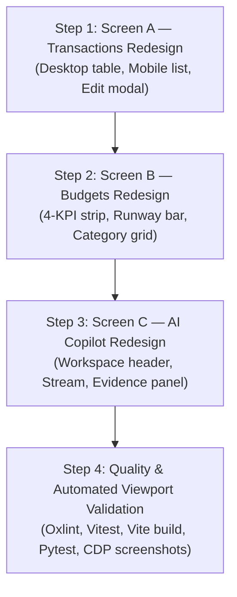

# PennyPilot — Phase 4 Stage 4: UI Redesign Implementation Plan

**Date:** 2026-11-06  
**Author:** Senior Staff Frontend & Financial Systems Engineer  
**Scope:** Stage 4 Comprehensive UI Redesign Plan for Transactions, Budgets, and AI Copilot  
**Status:** Strictly Planning Only — Awaiting Review & Authorization  
**Reference Visual Direction:** Modern Premium Fintech Dashboard ("Quiet Ledger" Archetype)  
**Baseline Git Commit:** `b1495c9`  

---

## 1. Executive Summary & Design Foundations

Following the successful completion of **Stage 3** (Executive Dashboard Redesign) and **Stage 3.1** (Responsive Dashboard Polish), the visual design language of PennyPilot is established:
- **Warm off-white archival canvas:** `#F7F5F0` (`bg-ledger-bg`)
- **Crisp white content surfaces:** `#FFFFFF` (`card-base`, `shadow-card`, hairline border `#E5E0D8`)
- **Deep green-teal accent:** `#0F766E` (`text-ledger-teal`, `bg-ledger-teal`)
- **Restrained semantic status tones:** Sage green (`#047857`) for positive surplus, Warm amber (`#B45309`) for budget cautions, Rose red (`#BE123C`) for overruns
- **Editorial Typography Hierarchy:** Newsreader serif for primary financial totals, Inter sans-serif for UI labels and metadata, JetBrains Mono for dates, currency figures, and tabular numbers (`tabular-nums`)
- **Strict Boundary Containment:** `min-w-0`, `overflow-hidden`, and dual-mode responsive presentation eliminating horizontal overflow at 320px–1440px

Stage 4 extends this aesthetic across the remaining three core screens:
1. **Screen A: Transactions (Financial Ledger)**
2. **Screen B: Budgets (Allocation & Spending Pace)**
3. **Screen C: AI Copilot (Grounded Financial Intelligence Workspace)**

---

## 2. Screen A: Financial Transactions Ledger

### 2.1 Current Implementation Assessment
- **Component File:** `frontend/src/components/transactions/TransactionList.tsx` (424 lines)
- **Defects & Inconsistencies:**
  - Uses generic `rounded-2xl` card styling instead of institutional `card-base` (`rounded-lg`).
  - Lacks top-level summary telemetry (total volume count, net filtered inflow/outflow).
  - Search and filter controls are rendered in an unstyled 4-column grid without compact filter chips.
  - Desktop table uses rounded pill category badges and lacks tabular figure alignment on amounts.
  - Mobile behavior relies on generic `overflow-x-auto` table scrolling rather than the dedicated mobile list pattern established in Stage 3.1 `RecentTransactionsCard`.
  - Edit modal uses `rounded-2xl` with default inputs rather than tokenized `input-base` components.
- **Strengths to Preserve:**
  - Sub-millisecond client-side filtering on search term, category, and transaction kind.
  - CSV export functionality.
  - Soft-delete and edit mutations with comprehensive TanStack Query cache invalidation.
  - Natural Language indicator (`NL`) for transactions parsed from natural language.

### 2.2 Proposed Layout & Visual Architecture
```
┌────────────────────────────────────────────────────────────────────────┐
│ TRANSACTIONS HEADER: Financial Ledger                                  │
│ Title: Financial Ledger | Subtitle: Integer-paise auditable records   │
│ [Export CSV] [Quick Add (+)]                                           │
├────────────────────────────────────────────────────────────────────────┤
│ TELEMETRY STRIP (3 Micro-KPIs)                                         │
│ Total Volume: 19 txs | Filtered Inflow: ₹85,000 | Outflow: ₹29,030     │
├────────────────────────────────────────────────────────────────────────┤
│ FILTER & SEARCH TOOLBAR                                                │
│ [Search description / merchant...] [All Types ▾] [Category ▾]          │
├────────────────────────────────────────────────────────────────────────┤
│ DESKTOP TABLE (>= md)                                                  │
│ Date (Mono) | Merchant & Description | Category | Source | Amount (₹)  │
│ 2026-11-05  | D-Mart - Weekly Groc   | Groceries| NL     | -₹3,110.00  │
├────────────────────────────────────────────────────────────────────────┤
│ MOBILE LEDGER LIST (< md)                                              │
│ [Icon] D-Mart                       -₹3,110.00                         │
│        Groceries • 2026-11-05 (NL)   [Edit] [Delete]                   │
└────────────────────────────────────────────────────────────────────────┘
```

### 2.3 Desktop vs Mobile Layout
- **Desktop (`>= md` / 768px–1440px):**
  - Institutional table matching `RecentTransactionsCard` styling.
  - Explicit column widths: Date (100px mono), Merchant & Description (flex-1), Category (140px badge-tag), Source (80px micro-badge), Amount (130px tabular-nums right-aligned), Actions (70px edit/delete icons).
  - Hover states on rows with hairline border dividers (`border-ledger-borderSubtle`).
- **Mobile (`< md` / 320px–767px):**
  - Dual-mode card list: each transaction is a vertical card item with a 44px+ tap zone.
  - Left: Merchant name in font-sans font-medium, subtitle with category badge and date.
  - Right: Bold tabular amount (`+₹XX,XXX.XX` in sage green, `-₹X,XXX.XX` in ink) and quick-action menu (Edit / Delete).
  - Strictly zero horizontal scrolling (`scrollWidth === clientWidth`).

### 2.4 Transaction Edit Modal Polish
- Centered modal using `card-base` styling (`rounded-lg`, `border-ledger-border`, `shadow-modal`).
- Input fields use `input-base` with floating labels and monospace rupee formatting (`paiseToRupees`).
- Accessible backdrop blur with `Escape` key dismissal and accessible focus trapping.

---

## 3. Screen B: Budget Management & Allocation Limits

### 3.1 Current Implementation Assessment
- **Component File:** `frontend/src/components/budgets/BudgetManagement.tsx` (296 lines)
- **Defects & Inconsistencies:**
  - Header month switcher is inconsistent with the polished `DashboardHeader` month controller.
  - Global KPI summary uses 3 cards with `rounded-xl` and bright primary backgrounds.
  - Global progress bar is overly thick (12px) with saturated red/amber/teal colors.
  - Category budget grid renders in `rounded-xl` boxes with disjointed inline edit buttons.
  - Lacks visual comparison between **elapsed month days** (e.g. Day 6 of 30) and **utilization percentage** (e.g. 52.8%), obscuring pacing intelligence.
- **Strengths to Preserve:**
  - Direct integration with `setMonthlyBudgets` API for setting integer paise category limits.
  - Real-time utilization calculation per category.
  - Fast optimistic UI updates with TanStack Query.

### 3.2 Proposed Layout & Visual Architecture
```
┌────────────────────────────────────────────────────────────────────────┐
│ BUDGET HEADER: Month Controller & Allocation Verdict                   │
│ [< November 2026 >] [Overall Pace: Over Pace] [Set Budgets]            │
│ Primary Verdict: ₹29,030.00 spent of ₹55,000.00 ceiling                │
│ [!] On pace to overspend by approximately ₹90,150.00 by month-end.     │
├────────────────────────────────────────────────────────────────────────┤
│ 4 BUDGET KPIS (Matching MetricCards Architecture)                      │
│ 1. Total Limit: ₹55,000 | 2. Total Spent: ₹29,030                      │
│ 3. Remaining: ₹25,970   | 4. Spending Pace: Day 6 of 30                │
├────────────────────────────────────────────────────────────────────────┤
│ GLOBAL RUNWAY & ALLOCATION VISUALIZER                                  │
│ Utilization: 52.8% of limit | Scheduled Day Pace: 20.0% (Day 6/30)     │
│ [==================|-----------------------] (Pace warning marker)     │
├────────────────────────────────────────────────────────────────────────┤
│ CATEGORY BUDGETS (2-Column Grid on Desktop, 1-Col on Mobile)           │
│ ┌──────────────────────────────┐ ┌──────────────────────────────┐      │
│ │ Housing & Rent               │ │ Dining & Food                │      │
│ │ Spent: ₹18,500 / ₹20,000     │ │ Spent: ₹7,020 / ₹8,000       │      │
│ │ [92.5% used • Over Pace]     │ │ [87.8% used • Caution]       │      │
│ │ [=============----] [Edit]   │ │ [===========------] [Edit]   │      │
│ └──────────────────────────────┘ └──────────────────────────────┘      │
└────────────────────────────────────────────────────────────────────────┘
```

### 3.3 Desktop vs Mobile Layout
- **Desktop (`>= md`):**
  - 4-card executive KPI strip matching `MetricCards` styling.
  - Segmented runway bar with elapsed day indicator and actual spend bar.
  - 2-column category budget grid: Each card displays category icon, name, status pill, amount spent of limit, remaining buffer, micro-progress bar, and inline limit adjuster.
- **Mobile (`< md`):**
  - 2-column or stacked 1-column KPI grid with responsive font scaling (`text-lg sm:text-xl`).
  - Stacked category budget cards with large tap targets (44px) for inline editing.
  - Slide-down or inline input with numerical keypad formatting (`step="100"`).

---

## 4. Screen C: AI Copilot (Financial Intelligence Workspace)

### 4.1 Current Implementation Assessment
- **Component Files:**
  - `frontend/src/components/copilot/CopilotView.tsx` (311 lines)
  - `frontend/src/components/copilot/EvidencePanel.tsx` (171 lines)
  - `frontend/src/components/copilot/MonthlyReportModal.tsx` (218 lines)
- **Defects & Inconsistencies:**
  - Chat window uses fixed height `h-[520px]`, causing nested double scrollbars on smaller laptop screens (e.g. 1280×800) and mobile viewports.
  - Chat bubbles use generic consumer app styling (`rounded-2xl`, stark black bubble for user, plain gray for assistant).
  - Suggested inquiry chips wrap awkwardly across multiple uneven lines.
  - Evidence panel displays raw tabular figures without the refined Quiet Ledger styling.
  - Top bar renders multiple disjointed status badges.
- **Strengths to Preserve:**
  - Strict Zero-Hallucination architecture: AI only receives verified Python `FactBundle` structures.
  - 3-tier fallback chain (Hosted Gemini -> Local Ollama -> Deterministic Engine).
  - Expandable FactBundle evidence panel citing exact dates, categories, and totals.
  - Comprehensive Monthly Intelligence Report modal with printable stylesheet.

### 4.2 Proposed Layout & Visual Architecture
```
┌────────────────────────────────────────────────────────────────────────┐
│ COPILOT WORKSPACE HEADER                                               │
│ Title: Financial Copilot | Subtitle: Verified facts & zero hallucination│
│ Active Engine: [• Local Ollama Qwen 2.5:3B] [Generate Monthly Report]  │
├────────────────────────────────────────────────────────────────────────┤
│ QUICK INQUIRY SHORTCUTS (Categorized Pills)                            │
│ [Spending Anomalies] [Budget Pace] [Top Outflow] [Savings Projection]  │
├────────────────────────────────────────────────────────────────────────┤
│ EDITORIAL CONVERSATION STREAM (Dynamic Viewport Height)                │
│                                                                        │
│   User: "Why did my expenses increase this month?"          [10:14 AM] │
│   ┌──────────────────────────────────────────────────────────────────┐ │
│   │ Copilot (Verified Analysis):                                     │ │
│   │ Your November 2026 expenses increased primarily due to Housing  │ │
│   │ (₹18,500.00) and a dining spike at The Table (₹4,200.00).       │ │
│   │                                                                  │ │
│   │ ▸ Inspect Verified Fact Bundle (Tier 2: Ollama Qwen 2.5:3B)      │ │
│   └──────────────────────────────────────────────────────────────────┘ │
│                                                                        │
├────────────────────────────────────────────────────────────────────────┤
│ INPUT CONSOLE (Sticky Docked)                                          │
│ [ Ask any question about your spending, pace, or outliers...  ] [Send] │
│ Subtext: Pure deterministic Python computation. Zero LLM calculations. │
└────────────────────────────────────────────────────────────────────────┘
```

### 4.3 Desktop vs Mobile Layout
- **Desktop (`>= md`):**
  - Flexible height container: `h-[calc(100vh-14rem)] min-h-[500px] max-h-[720px]`.
  - Assistant responses styled as editorial white cards (`card-base p-4 sm:p-5`) with serif headlines and tabular numbers.
  - Verified FactBundle evidence drawer opens inline with structured sub-cards (Totals, Anomaly Spikes, Category Percentages).
- **Mobile (`< md`):**
  - Viewport-aware layout: `h-[calc(100vh-12rem)] pb-safe`.
  - Fixed compact input bar docked above mobile bottom navigation.
  - Quick inquiry pills scroll horizontally without wrapping (`flex-nowrap overflow-x-auto no-scrollbar`).
  - Evidence panel renders as an accessible accordion preventing vertical sprawl.

---

## 5. Component Reuse & Design Token Strategy

To ensure 100% aesthetic consistency with the Dashboard and Institutional Shell, all three screens will reuse established patterns and design tokens:

| UI Pattern | Existing Canonical Source | Reused In Screen A (Txs) | Reused In Screen B (Budgets) | Reused In Screen C (Copilot) |
| :--- | :--- | :---: | :---: | :---: |
| **Card Surface** | `card-base` (`index.css`) | Ledger card & filters | Budget overview & categories | Chat stream & responses |
| **Buttons** | `btn-primary`, `btn-secondary` | Quick Add, Export CSV | Save budget, Month nav | Send query, Report CTA |
| **Inputs** | `input-base` (`index.css`) | Search, Edit form | Inline limit adjuster | Question input console |
| **Micro-Badges** | `badge-tag` (`index.css`) | Category & Type pills | Status pills (Over Pace) | AI Provider & Tier badge |
| **Numbers** | `tabular-nums font-mono` | Transaction amounts | Limits, spent, remaining | Telemetry figures |
| **Month Switcher**| `DashboardHeader.tsx` | (Optional date filter) | Month navigation bar | Report period picker |
| **Verdict Callout**| `DashboardHeader.tsx` | N/A | Global pacing warning | Fact check callout |

---

## 6. Exact Files Expected to Change

| # | File Path | Scope of Change | Risk Level |
| :-: | :--- | :--- | :---: |
| 1 | `frontend/src/components/transactions/TransactionList.tsx` | Redesign desktop table and mobile list; polish filters and edit modal | Medium |
| 2 | `frontend/src/components/budgets/BudgetManagement.tsx` | Redesign budget overview, 4-KPI cards, and category limit grid | Medium |
| 3 | `frontend/src/components/copilot/CopilotView.tsx` | Redesign chat stream, dynamic viewport sizing, and input dock | Medium |
| 4 | `frontend/src/components/copilot/EvidencePanel.tsx` | Refine FactBundle telemetry grid with Quiet Ledger design tokens | Low |
| 5 | `frontend/src/components/copilot/MonthlyReportModal.tsx` | Refine printable intelligence audit report styling | Low |
| 6 | `frontend/src/App.tsx` | Verify tab switching, responsive padding, and container containment | Low |

*Note: No backend files, database models, API schemas, or dependencies will be created or modified.*

---

## 7. Existing Backend APIs Utilized

All three screens will communicate strictly with existing, verified FastAPI endpoints under `/api/v1`:

### Screen A: Transactions
- `GET /api/v1/transactions` (List user transactions with pagination & sorting)
- `GET /api/v1/categories` (User-isolated category list)
- `PATCH /api/v1/transactions/{id}` (Update transaction details)
- `DELETE /api/v1/transactions/{id}` (Soft-delete transaction)
- `POST /api/v1/transactions` (Quick Add manual transaction)
- `POST /api/v1/transactions/parse-nl` (Natural language transaction parser)

### Screen B: Budgets
- `GET /api/v1/budgets?year={y}&month={m}` (Monthly budget overview with real-time utilization)
- `POST /api/v1/budgets` (Set per-category monthly budget ceilings in integer paise)
- `GET /api/v1/transactions/pace?year={y}&month={m}` (Spending pace projection in IST)

### Screen C: AI Copilot
- `POST /api/v1/copilot/query` (Ask grounded financial question with verified FactBundle)
- `GET /api/v1/copilot/status` (Get 3-tier fallback engine status: Gemini / Ollama / Python)
- `GET /api/v1/copilot/monthly-report?year={y}&month={m}` (Generate monthly audit report)

---

## 8. Interaction & Responsive Behavior

1. **Touch Targets:** Minimum 44×44px for all mobile interactive targets (buttons, pagination, tabs).
2. **Keyboard Navigation:** Full `Tab` and `Shift+Tab` accessibility with `focus-ring` visible indicators.
3. **Esc Key Handlers:** Modals and drawers close on `Escape` key press.
4. **Viewport Containment:** All containers enforce `min-w-0` and `overflow-hidden` to guarantee zero horizontal document overflow at 320px, 360px, 390px, 430px, 1280px, and 1440px.
5. **No Double Scrollbars:** Viewports use flex-1 layout with single contained scrolling containers.

---

## 9. Staged Implementation Order & Testing Strategy



### Verification & Testing Gates
1. **Frontend Linting:** `npm --prefix frontend run lint` (0 errors required).
2. **Frontend Unit Tests:** `npm --prefix frontend test -- --run` (100% pass required).
3. **Frontend Production Build:** `npm --prefix frontend run build` (TypeScript diagnostics 0, PWA generation).
4. **Backend Regression Suite:** `pytest -v -m "not slow"` (All 68 tests must pass).
5. **CDP Viewport Screenshot Audit:** Automated capture and overflow verification at 1440px, 1280px, 430px, 390px, 360px, and 320px (`hasOverflow: false`).

---

## 10. Architectural Guarantees & Constraints

1. **Strict $0 Zero-Budget Guarantee:** No paid APIs, libraries, fonts, or external SaaS dependencies.
2. **Strict Integer Paise Convention:** Monetary calculations remain exclusively integer paise in backend domain models and UI formatters.
3. **Zero Financial Hallucination:** AI Copilot displays only verified FactBundle data computed deterministically in pure Python.
4. **Multi-Tenant User Isolation:** Every query and mutation continues to strictly enforce authenticated `user_id` filtering.
5. **Design System Adherence:** Consistent application of the "Quiet Ledger" design system tokens.

---

*This document constitutes the complete design and implementation specification for Phase 4 Stage 4. Implementation will commence only upon explicit user authorization.*
