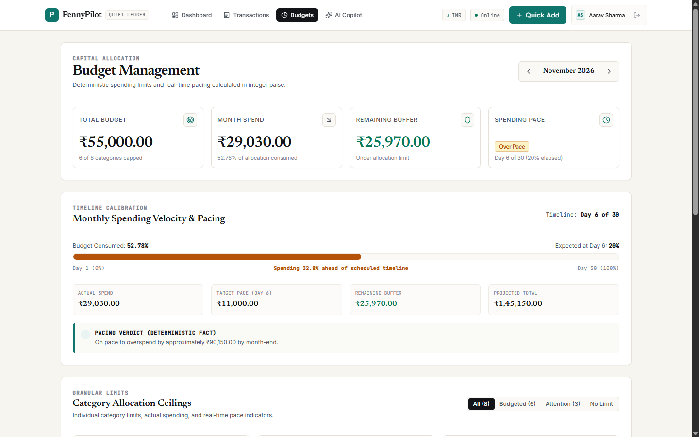
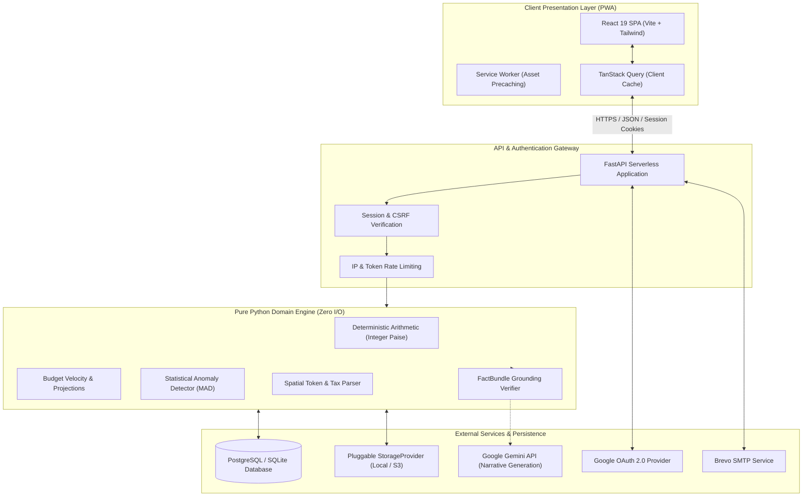

# PennyPilot

[](https://react.dev/)
[](https://fastapi.tiangolo.com/)
[](https://www.typescriptlang.org/)
[](https://www.python.org/)
[](https://web.dev/progressive-web-apps/)

> An intelligent, privacy-first personal finance platform combining deterministic accounting, grounded AI intelligence, and multi-format receipt digitization.

---

## Overview

**PennyPilot** is a modern personal finance and expense management platform built on deterministic arithmetic and grounded AI intelligence. Conventional financial tools often force users into tedious manual bookkeeping or present generic, ungrounded charts. PennyPilot couples a **pure, deterministic arithmetic domain engine** with **multimodal AI assistance**—performing all financial math, projections, and aggregations in pure Python integer arithmetic before providing verified `FactBundle` data structures to the language model for narration.

Built on the **"Quiet Ledger"** design philosophy, PennyPilot emphasizes typography-driven readability, high contrast compliance (WCAG AA), tabular financial figures, and a clutter-free editorial aesthetic across desktop, tablet, and mobile devices.

---

## Key Features

### 1. Deterministic Financial Ledger
- **Integer Paise Arithmetic:** All monetary values are calculated and stored strictly as integer paise (`₹1.00 = 100 paise`), avoiding IEEE 754 floating-point rounding discrepancies.
- **Granular Category Taxonomy:** Custom color-coded categories, subcategory tags, and customizable spending limits.
- **Bi-directional Ledger:** Real-time balance calculations, multi-parameter transaction filtering, and period-over-period aggregate reporting.

### 2. Multi-Format Receipt Digitization
- **Spatial OCR Reconstruction:** Intelligent bounding-box clustering reconstructs fragmented receipt rows into aligned tabular line items.
- **Indian Tax Disaggregation:** Accurately parses CGST, SGST, IGST, subtotal breakdowns, and prioritizes the true post-tax grand total over intermediate sub-totals or line items.
- **Review-Before-Commit Workflow:** Extracted transactions are presented in an editable preview modal, giving users full verification before saving to the ledger.

### 3. Grounded AI Financial Copilot ("Compute, Then Explain")
- **FactBundle Verification Architecture:** The generative model is strictly decoupled from financial arithmetic. Backend analytical engines compute verifiable `FactBundle` data structures in pure Python; the LLM receives these structured facts to translate them into clear narrative summaries.
- **Evidence Verification:** Narrative responses are cross-referenced against the underlying FactBundle before rendering.
- **Model Compatibility:** Configured for `gemini-3.8-flash` for multimodal receipt processing and narrative financial analysis (active when a Gemini API key is configured).

### 4. Natural Language Quick-Add
- **Conversational Logging:** Parse multi-item, mixed-currency expenses from plain language phrases (e.g., *"₹450 groceries and 120 coffee today"*).
- **Interactive Review:** Parses amount, category, date, and description into structured drafts for one-click confirmation.

### 5. Proactive Budget Intelligence
- **Velocity Tracking:** Real-time budget burn rate indicators comparing elapsed calendar days against actual spending momentum.
- **Predictive Overrun Alerts:** Proactive warnings flag categories tracking toward deficit before the billing cycle closes.
- **Statistical Anomaly Detection:** Applies Median Absolute Deviation (MAD) algorithms to identify irregular transaction spikes without assuming normal distribution curves.

### 6. Progressive Web App (PWA)
- **Offline Shell Precaching:** Service worker precaches the application shell for offline capability and fast load times.
- **Responsive Touch Architecture:** 44px minimum mobile tap targets, pull-down bottom sheets, and adaptive layouts optimized for viewports from 320px to large displays.

---

## Application Showcase

### Executive Financial Dashboard
The central command center provides high-density net worth indicators, dynamic monthly trend bars, and real-time category distribution.


### Budget Velocity & Spending Pace
Visual progress bars and burn-rate metrics contrast calendar day progress against actual consumption to prevent month-end overruns.



### Multi-Format Receipt Extraction
The automated document pipeline extracts merchant metadata, date, line items, and Indian GST breakdowns into an editable ledger draft.


### Cash Flow & Category Analytics
Multi-axis breakdown of spending patterns, monthly burn rates, and discretionary expense distributions.


### Responsive Mobile Experience
Full desktop capabilities encapsulated in an ergonomic mobile layout with bottom-sheet modals, tactile cards, and quick-action triggers.


---

## Technology Stack

```
┌────────────────────────────────────────────────────────────────────────────────────────┐
│                                   PENNYPILOT STACK                                     │
├───────────────────┬────────────────────────────────────────────────────────────────────┤
│ Frontend          │ React 19, TypeScript, Vite, Tailwind CSS, TanStack Query v5        │
│ UI & Data Viz     │ Lucide React, Recharts, Custom Quiet Ledger Design System          │
│ Backend Framework │ Python 3.10+, FastAPI (ASGI), Pydantic v2, Uvicorn                 │
│ Database & ORM    │ PostgreSQL 16 / SQLite, SQLAlchemy 2.0, Alembic Migrations         │
│ Storage Provider  │ Pluggable StorageProvider (Local Disk & S3-compatible interfaces)  │
│ Authentication    │ Google OAuth 2.0 (PKCE OpenID Connect), Bcrypt, PyJWT, First-Party │
│                   │ SameSite Session Cookies                                           │
│ AI & Vision       │ Google Gemini 3.8 Flash (Multimodal), RapidOCR Engine              │
│ Quality & Testing │ Pytest (automated unit, domain, API & security test suite), Vitest │
└───────────────────┴────────────────────────────────────────────────────────────────────┘
```

---

## System Architecture

PennyPilot enforces strict separation of concerns across client, gateway, domain, and data layers:



---

## Repository Structure

```
PennyPilot/
├── api/                      # Serverless application entry points
│   ├── index.py              # FastAPI serverless handler
│   └── requirements.txt      # Serverless runtime dependency manifest
├── backend/                  # Core Python Application
│   ├── app/
│   │   ├── api/v1/           # REST endpoints (auth, transactions, budgets, receipts)
│   │   ├── core/             # Configuration, cryptographic security, error handling
│   │   ├── db/               # SQLAlchemy database session & engine factory
│   │   ├── domain/           # Pure financial arithmetic, anomaly detection & parser
│   │   ├── models/           # SQLAlchemy ORM models
│   │   ├── schemas/          # Pydantic v2 validation models
│   │   └── services/         # Storage providers, AI clients, OAuth & email service
│   ├── tests/                # Automated Pytest suite (unit, domain, integration)
│   └── alembic/              # Database migration versions
├── frontend/                 # React 19 Client Application
│   ├── src/
│   │   ├── components/       # UI components (dashboard, ledger, budgets, copilot)
│   │   ├── context/          # Theme, notification, and auth state providers
│   │   ├── hooks/            # Data-fetching hooks (TanStack Query)
│   │   └── lib/              # API client, currency formatters, report generators
│   ├── public/               # PWA manifests, icons, static assets
│   └── vite.config.ts        # Vite build & PWA configuration
├── docs/                     # Architectural & security specifications
│   ├── ARCHITECTURE.md       # Detailed system design
│   ├── DESIGN_SYSTEM.md      # Quiet Ledger tokens & design specification
│   └── SECURITY.md           # Security architecture & threat modeling
├── screenshots/              # Polished application interface captures
├── vercel.json               # Serverless routing & build specification
├── requirements.txt          # Root Python dependency manifest
└── README.md
```

---

## Security & Data Integrity

PennyPilot implements strict security-by-design standards across all execution paths:

- **Server-Side Multi-Tenant Isolation:** Every database query filters by `user_id` enforced server-side. Client-side state is treated as untrusted.
- **Strict SameSite First-Party Cookies:** Authentication sessions, CSRF protections, and OAuth PKCE verifiers use `SameSite=Lax`, `Secure=True`, and `HttpOnly` cookie flags to eliminate token theft via Cross-Site Scripting (XSS).
- **Cryptographic Password Hashing:** User passwords are encrypted using Bcrypt with per-user cryptographic salts and minimum complexity enforcement.
- **Grounded FactBundle Architecture:** AI endpoints are decoupled from numerical calculations. All arithmetic, aggregations, and burn-rate metrics occur in pure Python integer paise, generating immutable `FactBundle` data structures that are cross-referenced with generated narrative output before presentation.
- **Authenticated File Access:** Receipt files are accessed through authenticated backend streaming endpoints (`/api/v1/receipts/{id}/download`), enforcing user session validation rather than exposing direct public storage URLs.

---

## Roadmap

- [ ] **Automated Bank Feed Integration:** Account Aggregator (AA) framework integration for consent-based Indian financial institution statement sync.
- [ ] **Predictive Cash Flow Modeling:** Machine learning projections based on historical income intervals and seasonal discretionary expenditure.
- [ ] **WebAuthn / Passkey Support:** Passwordless hardware key and biometric authentication.
- [ ] **Multi-Currency Portfolio Ledger:** Automated exchange rate conversion supporting USD, EUR, and GBP with real-time currency indexing.

---

## License

This repository does not currently include an open-source license. All rights are reserved. An open-source license may be designated in a future release.
